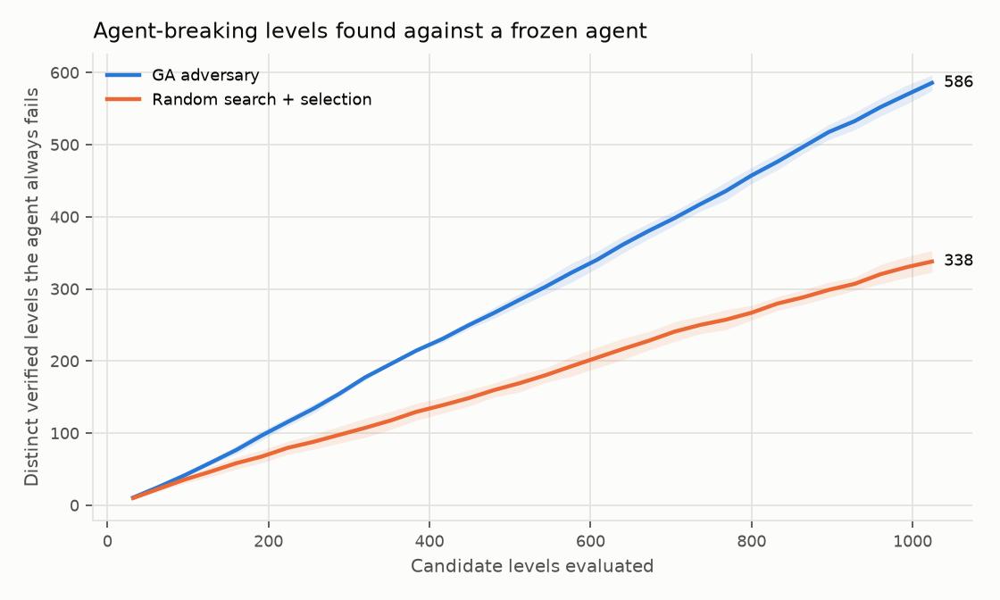
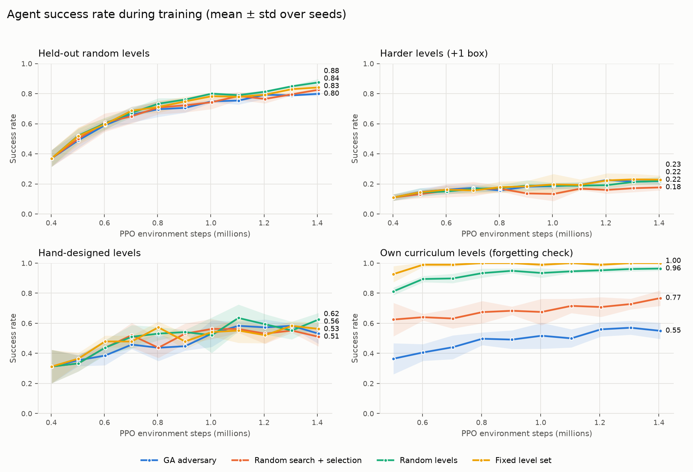
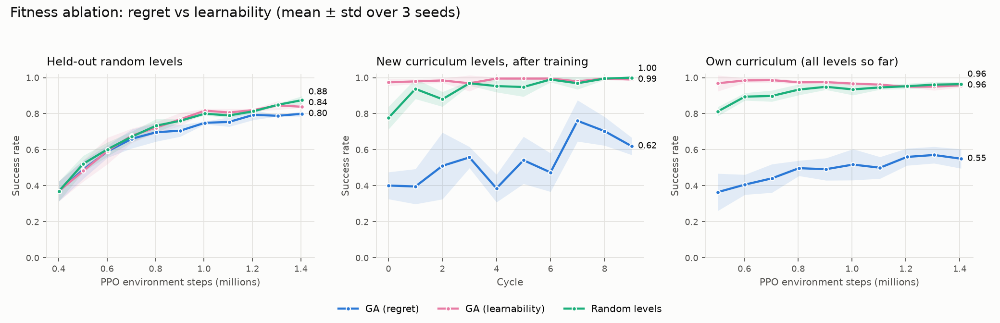

# Results and Discussion (draft)

> Draft for the project report. Numbers are taken from `runs/*/analysis/` and can be regenerated with
> `python -m levelforge ued-analyze` and `scripts/fitness_ablation.py`. All experiments listed under
> *Reproducibility* are complete.

## 5 Results

### 5.1 What is measured

Every condition starts from the same pretrained PPO agent (per seed), receives the same number of PPO
environment steps and adds the same number of new levels (16) to its training mixture per cycle. Only the
way the new levels are chosen differs (Table 1). Success rates are measured with a stochastic policy on test
sets that are never trained on. All results are mean ± standard deviation over 3 seeds; differences are
reported with a bootstrap 95 % confidence interval (CI) and an exact permutation test.

**Statistical caveat.** With 3 seeds per group the smallest attainable permutation p-value is 0.10, and the
bootstrap CI is computed from only 3 values per group. We therefore treat a CI that excludes zero, *together
with* a consistent sign across all seeds, as evidence of an effect, and avoid significance language
elsewhere.

**Table 1 – Conditions.**

| Condition | How the 16 new levels per cycle are chosen |
|---|---|
| GA adversary | evolved by the GA against the current agent (population persists across cycles) |
| Random search + selection | same number of candidates scored as the GA, drawn at random, top-16 kept |
| Random levels | 16 fresh random levels, no selection |
| Fixed level set | one set of 16 levels drawn once and reused |

Main setting: 7×7 boards, one box, 400 k pretraining steps followed by 10 cycles × 100 k steps (1.4 M steps
in total). The pretrained agents solve 35 ± 6 % of held-out levels, 13 ± 1 % of harder (+1 box) levels and
33 ± 3 % of the hand-designed puzzles.

### 5.2 RQ1 – Does the GA find agent-breaking levels more efficiently than random search?

With the agent frozen, the GA and random search each scored 1024 candidate levels per seed. We count
*distinct, solver-verified* levels on which the agent fails every trial (Table 2, Figure 1).

**Table 2 – Failure discovery against a frozen agent (1024 evaluations per seed).**

| Setting | GA | Random search | Ratio | Evaluations to find 50 (GA / random) |
|---|---|---|---|---|
| 7×7, 1 box | **585.7 ± 10.8** | 338.0 ± 15.3 | 1.73× | 128 / 149 |
| 7×7, 2 boxes | **704.7 ± 9.3** | 502.7 ± 10.4 | 1.40× | 96 / 96 |
| 9×9, 1 box | **672.7 ± 5.2** | 605.3 ± 9.8 | 1.11× | 96 / 107 |

The GA found 1.73× as many breaking levels as random search in the main setting, with no overlap between the
two methods across seeds (GA minimum 574, random-search maximum 358). The two curves coincide while the GA
population is still close to a random sample (both need 43 evaluations to find the first 10), then diverge
steadily once selection and crossover take effect (Figure 1).

With two boxes the GA's advantage is smaller in ratio (1.40×; GA minimum 692 vs random-search maximum 511)
because the weaker two-box agent fails roughly half of all random levels, so random search already finds
breaking levels easily; in absolute terms the GA still finds about 200 more per 1024 evaluations. (In this
attack the GA always selects by regret, whatever fitness the curriculum experiment uses. A first run that
mistakenly selected by learnability found only 627 ± 15, which shows that the search objective matters.)

On the 9×9 board the GA again wins on every seed (minimum 669 vs random-search maximum 617), but by only
1.11×. Across the three settings, the GA's relative advantage shrinks as breaking levels become common: random
search finds a breaking level in 33 % (7×7, one box), 49 % (two boxes) and 59 % (9×9) of its candidates, and
the GA's ratio falls from 1.73× to 1.40× to 1.11×. Evolution pays off most when failures are rare and must
be searched for, which is the regime that matters for testing a strong agent.

The answer to RQ1 is therefore **yes**: evolution, not just selection from the same
number of random candidates, is what produces the gain.

*Figure 1 – Distinct verified agent-breaking levels found as a function of candidates evaluated (7×7, one box).*

### 5.3 RQ2 – Does training on GA levels produce a more robust agent?

**Table 3 – Final success rates, 7×7 one box (mean ± std over 3 seeds; Δ = GA − baseline).**

| Test set | GA adversary (regret) | Random search | Random levels | Fixed set |
|---|---|---|---|---|
| Held-out random | 0.810 ± 0.028 | 0.822 ± 0.011 | **0.860 ± 0.018** | 0.844 ± 0.005 |
| Harder (+1 box) | 0.219 ± 0.022 | 0.182 ± 0.015 | 0.232 ± 0.026 | **0.238 ± 0.053** |
| Hand-designed | 0.604 ± 0.015 | 0.573 ± 0.058 | **0.641 ± 0.026** | 0.594 ± 0.022 |
| Other seeds' GA levels | 0.199 ± 0.048 | 0.203 ± 0.044 | 0.242 ± 0.014 | **0.257 ± 0.030** |

The GA curriculum did **not** produce a more robust agent. Training on plain random levels was best on
held-out levels (Δ = −0.050, CI [−0.085, −0.011]) and on the hand-designed puzzles (Δ = −0.036,
CI [−0.068, −0.005]). On the other test sets all differences lie within seed-to-seed variation. Most notably,
GA-trained agents were *not* harder to break with GA levels from other seeds' runs (0.20, against 0.24 for
random-level training), although this is the distribution the GA curriculum was expected to prepare them for.

*Figure 2 – Success during training on each test set, and on each condition's own curriculum (bottom right).*

### 5.4 Why the adversarial curriculum did not help

Table 4 describes what each condition put into the curriculum.

**Table 4 – Curriculum diagnostics, 7×7 one box (mean over cycles and seeds).**

| Statistic | GA (regret) | Random search | Random levels | Fixed set |
|---|---|---|---|---|
| Success on new levels *before* training | 0.00 | 0.03 | 0.70 | 0.94 |
| Success on new levels *after* training | 0.53 | 0.73 | 0.94 | 0.99 |
| Regret of new levels | 1.00 | 1.00 | 0.47 | 0.15 |
| Optimal solution length (moves) | 10.8 | 8.4 | 5.2 | 5.4 |
| Final success on own curriculum | 0.55 | 0.77 | 0.96 | 1.00 |

The regret-driven GA does exactly what it is asked to do: every level it adds is one the agent never solves
(regret 1.00), and these levels need about twice as many moves as random ones. But after a cycle of training
the agent solves only about half of them, and at the end it still fails 45 % of its own curriculum. The
curriculum sits *beyond* the agent's learning frontier: much of the training budget is spent on episodes that
end without reward. A strong adversary is not automatically a good teacher.

### 5.5 Ablation 1 – Regret versus learnability fitness

To test this explanation we re-ran the GA condition with the *learnability* fitness p(1−p), which is largest
for levels the agent solves about half of the time (as in PLR and ACCEL). Everything else, including the
pretrained checkpoints, was identical.

**Table 5 – Fitness ablation, 7×7 one box.**

| | GA (regret) | GA (learnability) | Random levels |
|---|---|---|---|
| Success on new levels before → after training | 0.00 → 0.53 | 0.51 → **0.99** | 0.70 → 0.94 |
| Final success on own curriculum | 0.55 | **0.96** | 0.96 |
| Held-out random | 0.810 ± 0.028 | 0.833 ± 0.014 | **0.860 ± 0.018** |
| Harder (+1 box) | 0.219 ± 0.022 | 0.196 ± 0.054 | **0.232 ± 0.026** |
| Hand-designed | 0.604 ± 0.015 | 0.578 ± 0.038 | **0.641 ± 0.026** |
| Regret-GA levels from other seeds | 0.199 ± 0.048 | **0.245 ± 0.023** | 0.242 ± 0.014 |

The learnability GA selected levels at the intended difficulty (51 % success before training), and the agent
mastered them (99 % after training). This removes the regret GA's deficit on adversarial levels
(0.20 → 0.25) and narrows the held-out gap, which confirms the frontier explanation. It still does not
outperform training on random levels in this setting.

*Figure 3 – Regret vs learnability fitness: held-out success, success on each cycle's new levels after
training, and success on the agent's own curriculum.*

### 5.6 Ablation 2 – Share of new levels in the training mixture

In the main design only 40 % of each cycle's training comes from the newly chosen levels (the rest is a
shared random pool and replay), which could dilute any curriculum effect. We repeated the learnability-GA and
random-level conditions with a 70 % share (10 % pool, 70 % new, 20 % replay).

**Table 6 – Effect of the new-level share (GA = learnability GA; Δ = GA − random levels).**

| Test set | GA, 40 % | Random, 40 % | Δ at 40 % | GA, 70 % | Random, 70 % | Δ at 70 % |
|---|---|---|---|---|---|---|
| Held-out random | 0.833 | 0.860 | −0.027 | 0.780 | 0.805 | −0.024 |
| Harder (+1 box) | 0.196 | 0.232 | −0.036 | 0.227 | 0.171 | **+0.056** [+0.006, +0.138] |
| Hand-designed | 0.578 | 0.641 | −0.062 | 0.573 | 0.495 | +0.078 [−0.031, +0.177] |

With the larger share the GA leads on both out-of-distribution sets. On the harder set, the CI excludes zero.
However, the GA agent's own scores hardly change (harder 0.20 → 0.23, hand-designed 0.58 → 0.57); the reversal
comes mainly from the random-level baseline getting worse (0.23 → 0.17 and 0.64 → 0.50). With 70 % of
training drawn from only 16 new random levels per cycle, that baseline sees far less variety than the
3000-level shared pool provides. The correct reading is that **GA-selected levels remain an effective
training signal when they dominate the mixture, whereas an equally small set of random levels does not**, not
that the 40 % design was suppressing a GA advantage.

### 5.7 Scaling up: more boxes and a larger board

A calibration run (`scripts/scale_calibration.py`, 1.5 M PPO steps per setting) fixed which scaled settings
were feasible on a CPU:

**Table 7 – PPO held-out success after 1.5 M steps (calibration).**

| Setting | Success | Used for |
|---|---|---|
| 7×7, 2 boxes | 0.33 | "more boxes" experiment (1.5 M pretraining) |
| 9×9, 1 box | 0.42 | "larger board" experiment (1.25 M pretraining) |
| 9×9, 2 boxes | 0.17 | not run on CPU; GPU configuration provided (`configs/ued_9x9_2box.json`) |

Both scaled experiments use learnability fitness, 10 cycles × 150 k steps and new hand-designed test sets
(12 two-box puzzles for 7×7; the 7×7 one-box puzzles embedded in a 9×9 frame for the larger board).

**Table 8 – More boxes: 7×7, two boxes (GA = learnability GA).**

| Test set | GA | Random search | Random levels |
|---|---|---|---|
| Held-out random (2 boxes) | 0.461 ± 0.038 | **0.470 ± 0.008** | 0.455 ± 0.023 |
| Harder (3 boxes) | 0.308 ± 0.020 | **0.330 ± 0.007** | 0.275 ± 0.032 |
| Hand-designed (2-box puzzles) | **0.458 ± 0.059** | **0.458 ± 0.000** | 0.403 ± 0.097 |
| Other seeds' GA levels | **0.446 ± 0.043** | 0.377 ± 0.023 | 0.355 ± 0.054 |

With two boxes the GA-trained agent is the most robust on levels evolved by other seeds' GAs: +0.091 over
random levels (CI [+0.015, +0.166]) and +0.069 over random search (CI [+0.018, +0.128]). This is the
first setting in which the adversarial curriculum gives a measurable robustness gain. Note that in this
experiment the adversarial test set comes from learnability GAs, the same kind of generator the GA agent was
trained against, so part of the gain reflects training on a similar level distribution. On held-out,
harder and hand-designed levels, the three conditions are statistically indistinguishable, with a slight
edge for the two selection-based methods over random levels on the harder and hand-designed sets.

**Table 9 – Larger board: 9×9, one box (GA = learnability GA).**

| Test set | GA | Random levels | Δ (GA − random) [95 % CI] |
|---|---|---|---|
| Held-out random | 0.579 ± 0.093 | 0.611 ± 0.122 | −0.032 [−0.190, +0.135] |
| Harder (+1 box) | 0.064 ± 0.007 | 0.064 ± 0.003 | +0.000 [−0.009, +0.008] |
| Hand-designed (7×7 puzzles in a 9×9 frame) | 0.365 ± 0.039 | 0.422 ± 0.135 | −0.057 [−0.234, +0.078] |
| Other seeds' GA levels | 0.494 ± 0.056 | 0.443 ± 0.085 | +0.051 [−0.061, +0.167] |

On the larger board the two conditions cannot be told apart on any test set. The GA again points in the
direction of better robustness on adversarial levels (+0.05), but the CI includes zero. Seed variation is
large here: the three pretrained agents start at 18 %, 36 % and 37 % held-out success, so final standard
deviations reach 0.09–0.14. Two-box levels on a 9×9 board (6 % success for every agent) are beyond what any
agent learned within this budget. As in the other settings, the GA's levels were well matched to the agent
(49 % success before training, 95 % after) and better retained than random ones (final success on own
curriculum 0.91 vs 0.79).

**Summary across settings.** The adversarial-curriculum effect on *adversarial* levels follows the same
direction in all learnability-GA experiments (+0.003 for 7×7 one box, +0.091 for two boxes, +0.051 for 9×9),
and it is clearly positive only with two boxes. On held-out random levels no GA curriculum ever beat random
training.

## 6 Discussion

### 6.1 Answer to the research question

The research question had two parts.

1. **Failure discovery: yes.** A classical GA with crossover and A*-verified offspring finds agent-breaking
   levels much more efficiently than random search with identical selection: 1.73× as many in the main
   setting, 1.40× with two boxes and 1.11× on the 9×9 board, winning on every seed in every setting. The
   advantage is largest when breaking levels are rare.
2. **Robustness from the adversarial curriculum: not in general.** On one-box 7×7 Sokoban, no GA curriculum
   beat equal-budget training on random levels on held-out or hand-designed puzzles, and the same holds for
   the two-box and 9×9 settings. A benefit appears only on the adversarial distribution, and is clear only in
   the two-box setting.

### 6.2 A good adversary is not a good teacher

The central finding is the gap between these two answers. The regret objective (PAIRED-style, with an exact
A* planner as the reference) is an excellent *search* objective: it finds levels that break the agent. As a
*curriculum* objective, it selects levels the agent cannot yet learn from (Table 4). This matches the
motivation of Prioritized Level Replay and ACCEL, which select by estimated learning potential rather than
maximum difficulty. Our ablation reproduces that argument within a single controlled system: switching only
the fitness function moves the curriculum onto the learning frontier and removes the regret GA's deficit
(Table 5).

### 6.3 Why random levels are a strong baseline here

On small one-box boards, random levels already sit close to the agent's frontier: during training the agent
solves about 70 % of each cycle's new random levels before it has trained on them (Table 4), so random
sampling naturally provides a mixture of easy and learnable levels. The
benefit of a designed curriculum should grow when random levels are less informative, i.e. when they are
mostly trivial or mostly impossible for the agent. The two-box results are consistent with this: as the
puzzle becomes combinatorially harder, the GA's advantage appears on the adversarial distribution
(Table 8). Testing this with larger budgets is the most important extension (§6.5).

### 6.4 Threats to validity

* **Seeds.** Three seeds per condition limit statistical power (minimum p = 0.10). Seed-to-seed standard
  deviations are 0.01–0.06, so effects of a few percentage points cannot be distinguished from seed variation.
* **Scale.** The boards are small and the PPO budgets modest (1.4–3 M steps) because all runs were done on
  a laptop CPU. The most interesting setting (9×9, two boxes) was out of reach.
* **Shared design choices.** All conditions use the same training mixture, pretraining and PPO
  hyper-parameters. These were tuned for random-level training and may favour it.
* **Adversarial test set.** "Other seeds' GA levels" is produced by the same kind of generator as one of the
  conditions, which gives that condition an in-distribution advantage. We use other seeds' archives so that no
  agent is tested on its own training levels.
* **Deadlock detection.** The dead-square analysis is exact only for single-box deadlocks; multi-box
  (freeze) deadlocks end by timeout rather than being labelled. This affects failure labelling, not success.

### 6.5 Future work

* Scale to 9×9 boards with two or more boxes on a GPU (configuration and calibration provided).
* Use five or more seeds so that significance claims become possible.
* Combine the two objectives: regret for discovering failure modes, learnability for choosing which levels
  to train on (e.g. evolve with regret, then replay the archive by learnability, as in ACCEL).
* Train the agent on a curriculum that adapts the new-level share to the agent's progress.

## Reproducibility

| Experiment | Directory | Config |
|---|---|---|
| Main (4 conditions × 3 seeds, attack) | `runs/ued_7x7` | `configs/ued_7x7.json` |
| Fitness ablation | `runs/ued_7x7_learn` | `configs/ued_7x7.json` + `--fitness learnability` |
| Mixture-share ablation | `runs/ued_7x7_mix70` | `configs/ued_7x7_mix70.json` |
| More boxes | `runs/ued_7x7_2box` | `configs/ued_7x7_2box.json` |
| Larger board | `runs/ued_9x9_1box` | `configs/ued_9x9_1box.json` |
| Scale calibration | `runs/scale_calibration` | `scripts/scale_calibration.py` |
