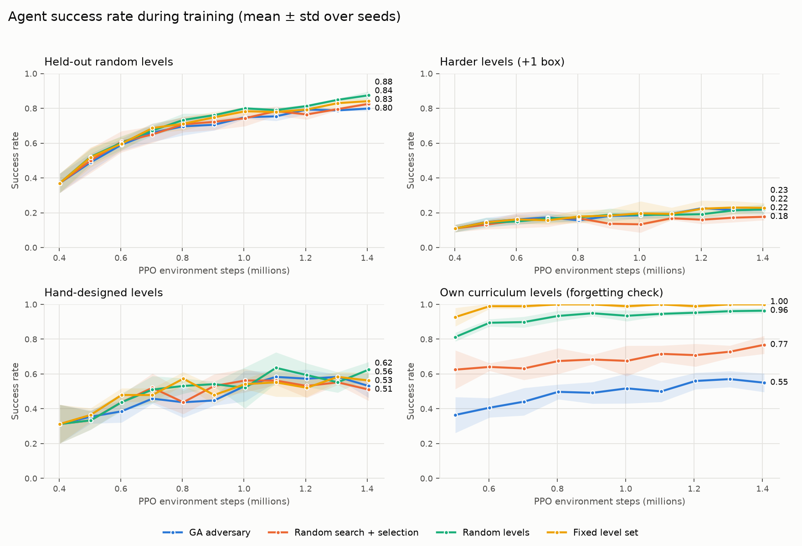
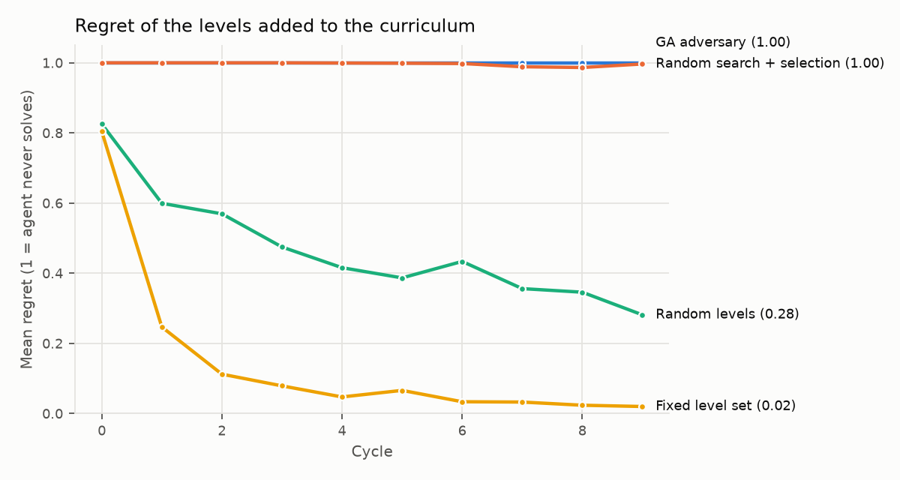
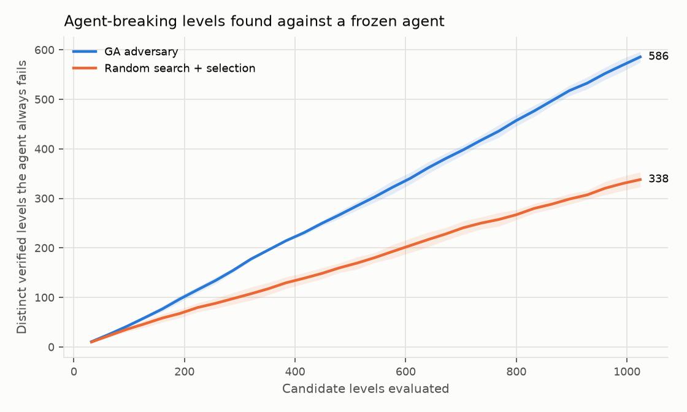

# Results

Experiment directory: `runs\ued_7x7`

Final success rates (stochastic policy), mean ± std across seeds; Δ vs GA with bootstrap 95% CI and exact permutation p-value.

## Held-out random levels

| Condition | Seeds | Success rate | Δ (GA − this) | 95% CI | p |
|---|---|---|---|---|---|
| GA adversary | 3 | 0.810 ± 0.028 | – | – | – |
| Random search + selection | 3 | 0.822 ± 0.011 | -0.012 | [-0.043, +0.024] | 0.600 |
| Random levels | 3 | 0.860 ± 0.018 | -0.050 | [-0.085, -0.011] | 0.200 |
| Fixed level set | 3 | 0.844 ± 0.005 | -0.034 | [-0.062, +0.003] | 0.400 |

## Harder levels (+1 box)

| Condition | Seeds | Success rate | Δ (GA − this) | 95% CI | p |
|---|---|---|---|---|---|
| GA adversary | 3 | 0.219 ± 0.022 | – | – | – |
| Random search + selection | 3 | 0.182 ± 0.015 | +0.037 | [+0.009, +0.068] | 0.100 |
| Random levels | 3 | 0.232 ± 0.026 | -0.013 | [-0.049, +0.024] | 0.600 |
| Fixed level set | 3 | 0.238 ± 0.053 | -0.019 | [-0.077, +0.052] | 0.700 |

## Hand-designed levels

| Condition | Seeds | Success rate | Δ (GA − this) | 95% CI | p |
|---|---|---|---|---|---|
| GA adversary | 3 | 0.604 ± 0.015 | – | – | – |
| Random search + selection | 3 | 0.573 ± 0.058 | +0.031 | [-0.036, +0.104] | 0.700 |
| Random levels | 3 | 0.641 ± 0.026 | -0.036 | [-0.068, -0.005] | 0.200 |
| Fixed level set | 3 | 0.594 ± 0.022 | +0.010 | [-0.021, +0.036] | 0.600 |

## Adversarial levels (other seeds' GA)

| Condition | Seeds | Success rate | Δ (GA − this) | 95% CI | p |
|---|---|---|---|---|---|
| GA adversary | 3 | 0.199 ± 0.048 | – | – | – |
| Random search + selection | 3 | 0.203 ± 0.044 | -0.004 | [-0.075, +0.067] | 1.000 |
| Random levels | 3 | 0.242 ± 0.014 | -0.043 | [-0.107, +0.002] | 0.400 |
| Fixed level set | 3 | 0.257 ± 0.030 | -0.058 | [-0.123, +0.000] | 0.300 |

## Failure-discovery efficiency (frozen agent)

| Method | Breaking levels found (mean ± std) | Evaluations to find 10 | Evaluations to find 25 | Evaluations to find 50 |
|---|---|---|---|---|
| GA adversary | 585.7 ± 10.8 | 43 (3/3 seeds) | 75 (3/3 seeds) | 128 (3/3 seeds) |
| Random search + selection | 338.0 ± 15.3 | 43 (3/3 seeds) | 85 (3/3 seeds) | 149 (3/3 seeds) |

## Figures

