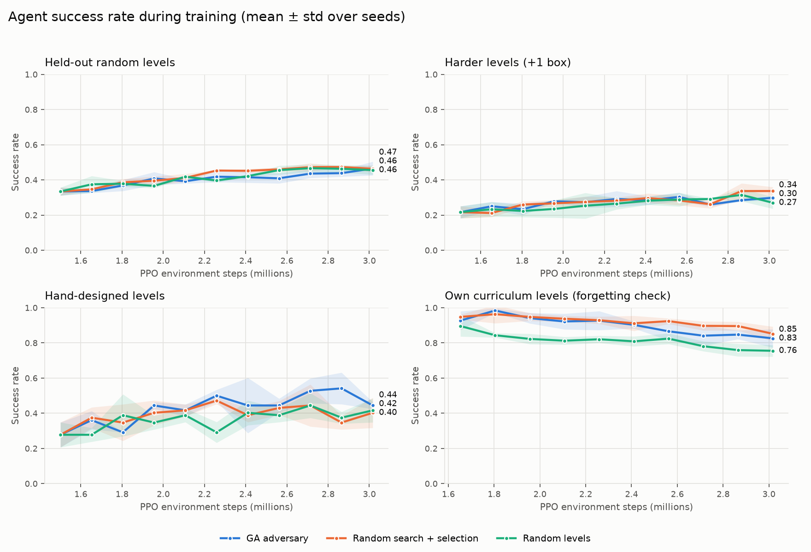
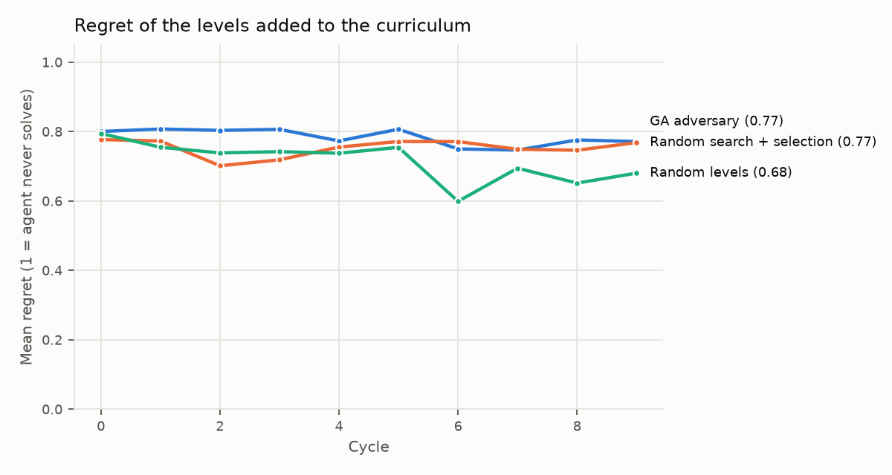
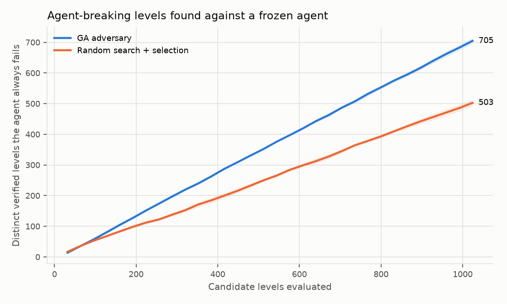

# Results

Experiment directory: `runs\ued_7x7_2box`

Final success rates (stochastic policy), mean ± std across seeds; Δ vs GA with bootstrap 95% CI and exact permutation p-value.

## Held-out random levels

| Condition | Seeds | Success rate | Δ (GA − this) | 95% CI | p |
|---|---|---|---|---|---|
| GA adversary | 3 | 0.461 ± 0.038 | – | – | – |
| Random search + selection | 3 | 0.470 ± 0.008 | -0.010 | [-0.054, +0.040] | 0.700 |
| Random levels | 3 | 0.455 ± 0.023 | +0.006 | [-0.042, +0.055] | 1.000 |

## Harder levels (+1 box)

| Condition | Seeds | Success rate | Δ (GA − this) | 95% CI | p |
|---|---|---|---|---|---|
| GA adversary | 3 | 0.308 ± 0.020 | – | – | – |
| Random search + selection | 3 | 0.330 ± 0.007 | -0.022 | [-0.048, +0.000] | 0.300 |
| Random levels | 3 | 0.275 ± 0.032 | +0.033 | [-0.008, +0.075] | 0.300 |

## Hand-designed levels

| Condition | Seeds | Success rate | Δ (GA − this) | 95% CI | p |
|---|---|---|---|---|---|
| GA adversary | 3 | 0.458 ± 0.059 | – | – | – |
| Random search + selection | 3 | 0.458 ± 0.000 | +0.000 | [-0.042, +0.083] | 1.000 |
| Random levels | 3 | 0.403 ± 0.097 | +0.056 | [-0.062, +0.188] | 0.600 |

## Adversarial levels (other seeds' GA)

| Condition | Seeds | Success rate | Δ (GA − this) | 95% CI | p |
|---|---|---|---|---|---|
| GA adversary | 3 | 0.446 ± 0.043 | – | – | – |
| Random search + selection | 3 | 0.377 ± 0.023 | +0.069 | [+0.018, +0.128] | 0.100 |
| Random levels | 3 | 0.355 ± 0.054 | +0.091 | [+0.015, +0.166] | 0.300 |

## Failure-discovery efficiency (frozen agent)

| Method | Breaking levels found (mean ± std) | Evaluations to find 10 | Evaluations to find 25 | Evaluations to find 50 |
|---|---|---|---|---|
| GA adversary | 704.7 ± 9.3 | 32 (3/3 seeds) | 64 (3/3 seeds) | 96 (3/3 seeds) |
| Random search + selection | 502.7 ± 10.4 | 32 (3/3 seeds) | 64 (3/3 seeds) | 96 (3/3 seeds) |

## Figures

