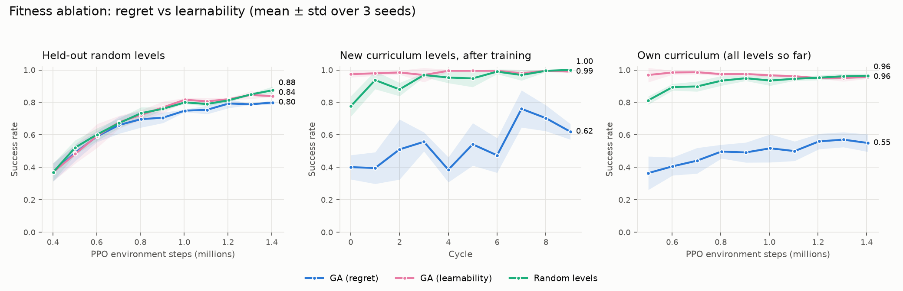

# Fitness ablation: regret vs learnability

Main experiment: `runs\ued_7x7` (GA uses regret). Ablation: `runs\ued_7x7_learn` (GA uses learnability p(1−p)).
Same pretrained checkpoints, budgets, test sets and seeds; only the GA fitness differs. Adversarial set = other seeds' *regret*-GA archives, identical to the main table.

## Held-out random levels

| Condition | Seeds | Success rate | Δ (GA-learnability − this) | 95% CI | p |
|---|---|---|---|---|---|
| GA (regret) | 3 | 0.810 ± 0.028 | +0.023 | [-0.015, +0.057] | 0.400 |
| **GA (learnability)** | 3 | **0.833 ± 0.014** | – | – | – |
| Random search + selection | 3 | 0.822 ± 0.011 | +0.011 | [-0.009, +0.032] | 0.500 |
| Random levels | 3 | 0.860 ± 0.018 | -0.027 | [-0.051, -0.002] | 0.300 |
| Fixed level set | 3 | 0.844 ± 0.005 | -0.011 | [-0.028, +0.005] | 0.500 |

## Harder levels (+1 box)

| Condition | Seeds | Success rate | Δ (GA-learnability − this) | 95% CI | p |
|---|---|---|---|---|---|
| GA (regret) | 3 | 0.219 ± 0.022 | -0.023 | [-0.082, +0.047] | 0.600 |
| **GA (learnability)** | 3 | **0.196 ± 0.054** | – | – | – |
| Random search + selection | 3 | 0.182 ± 0.015 | +0.014 | [-0.038, +0.088] | 0.900 |
| Random levels | 3 | 0.232 ± 0.026 | -0.036 | [-0.097, +0.038] | 0.500 |
| Fixed level set | 3 | 0.238 ± 0.053 | -0.043 | [-0.124, +0.040] | 0.500 |

## Hand-designed levels

| Condition | Seeds | Success rate | Δ (GA-learnability − this) | 95% CI | p |
|---|---|---|---|---|---|
| GA (regret) | 3 | 0.604 ± 0.015 | -0.026 | [-0.073, +0.021] | 0.500 |
| **GA (learnability)** | 3 | **0.578 ± 0.038** | – | – | – |
| Random search + selection | 3 | 0.573 ± 0.058 | +0.005 | [-0.073, +0.083] | 1.000 |
| Random levels | 3 | 0.641 ± 0.026 | -0.062 | [-0.115, -0.010] | 0.200 |
| Fixed level set | 3 | 0.594 ± 0.022 | -0.016 | [-0.062, +0.031] | 1.000 |

## Adversarial levels (other seeds' regret-GA)

| Condition | Seeds | Success rate | Δ (GA-learnability − this) | 95% CI | p |
|---|---|---|---|---|---|
| GA (regret) | 3 | 0.199 ± 0.048 | +0.046 | [-0.006, +0.113] | 0.500 |
| **GA (learnability)** | 3 | **0.245 ± 0.023** | – | – | – |
| Random search + selection | 3 | 0.203 ± 0.044 | +0.042 | [-0.010, +0.097] | 0.400 |
| Random levels | 3 | 0.242 ± 0.014 | +0.003 | [-0.024, +0.035] | 0.800 |
| Fixed level set | 3 | 0.257 ± 0.030 | -0.012 | [-0.052, +0.030] | 0.900 |

## What each GA put into the curriculum

| Curriculum statistic (mean over cycles and seeds) | GA (regret) | GA (learnability) | Random search + selection | Random levels | Fixed level set |
|---|---|---|---|---|---|
| New levels: success before training | 0.00 | 0.51 | 0.03 | 0.70 | 0.94 |
| New levels: success after training | 0.53 | 0.99 | 0.73 | 0.94 | 0.99 |
| New levels: regret | 1.00 | 0.73 | 1.00 | 0.47 | 0.15 |
| New levels: optimal solution length (moves) | 10.76 | 6.84 | 8.44 | 5.22 | 5.38 |
| Own curriculum: final success | 0.55 | 0.96 | 0.77 | 0.96 | 1.00 |
| GA offspring passing A* verification | 0.48 | 0.49 | – | – | – |

