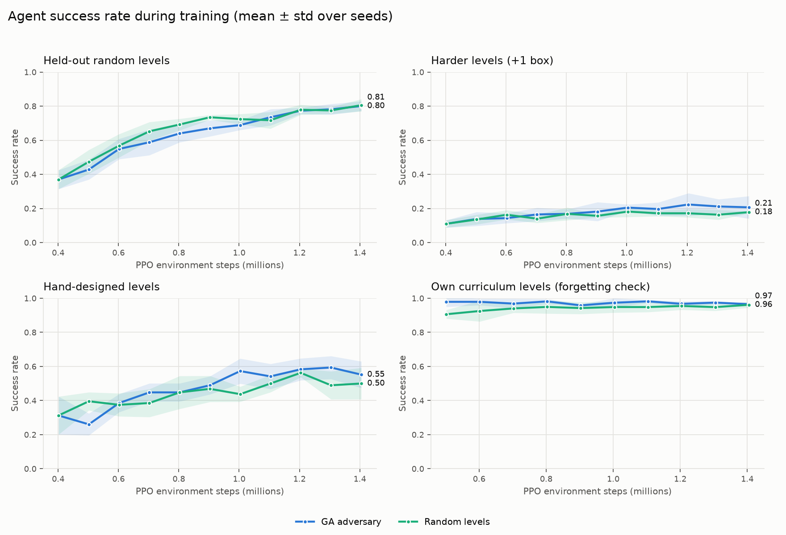
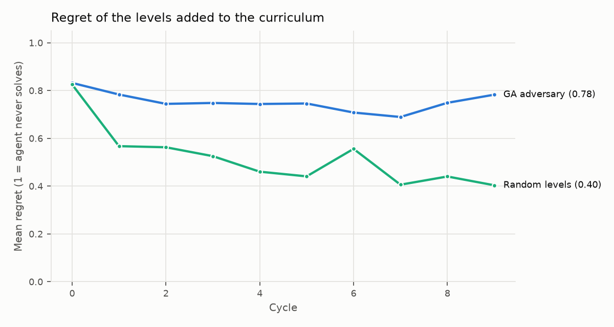

# Results

Experiment directory: `runs\ued_7x7_mix70`

Final success rates (stochastic policy), mean ± std across seeds; Δ vs GA with bootstrap 95% CI and exact permutation p-value.

## Held-out random levels

| Condition | Seeds | Success rate | Δ (GA − this) | 95% CI | p |
|---|---|---|---|---|---|
| GA adversary | 3 | 0.780 ± 0.030 | – | – | – |
| Random levels | 3 | 0.805 ± 0.029 | -0.024 | [-0.068, +0.020] | 0.400 |

## Harder levels (+1 box)

| Condition | Seeds | Success rate | Δ (GA − this) | 95% CI | p |
|---|---|---|---|---|---|
| GA adversary | 3 | 0.227 ± 0.059 | – | – | – |
| Random levels | 3 | 0.171 ± 0.010 | +0.056 | [+0.006, +0.138] | 0.100 |

## Hand-designed levels

| Condition | Seeds | Success rate | Δ (GA − this) | 95% CI | p |
|---|---|---|---|---|---|
| GA adversary | 3 | 0.573 ± 0.091 | – | – | – |
| Random levels | 3 | 0.495 ± 0.027 | +0.078 | [-0.031, +0.177] | 0.400 |

## Figures

