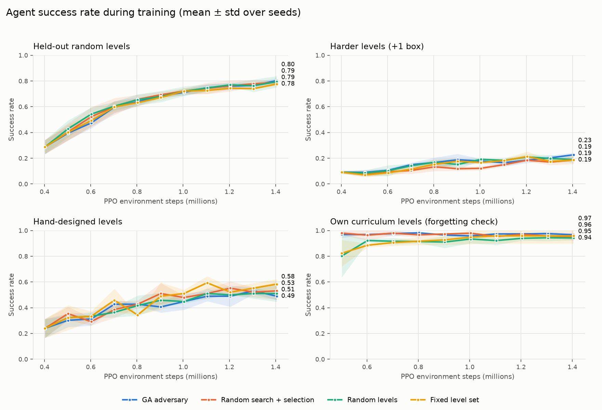
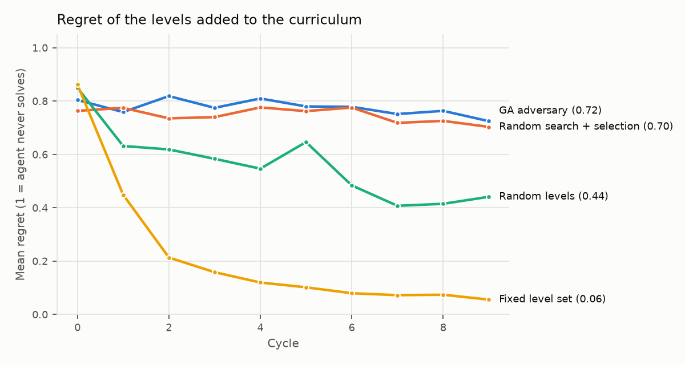
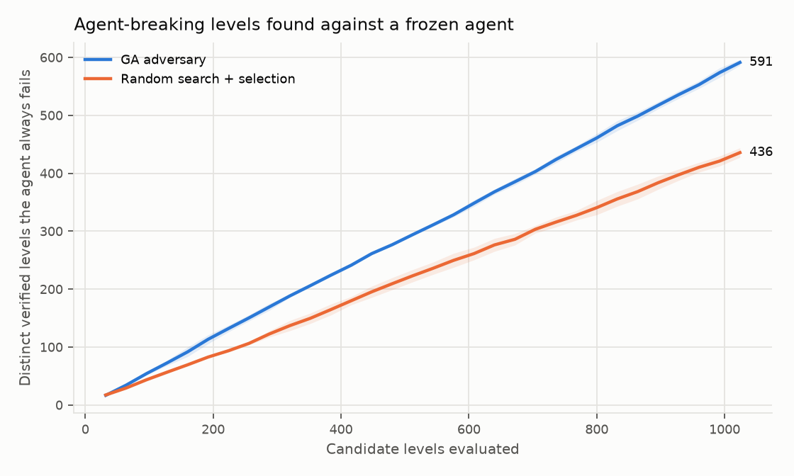

# Results

Experiment directory: `runs\ued_7x7_payload`

Final success rates (stochastic policy), mean ± std across seeds; Δ vs GA with bootstrap 95% CI and exact permutation p-value.

## Held-out random levels

| Condition | Seeds | Success rate | Δ (GA − this) | 95% CI | p |
|---|---|---|---|---|---|
| GA adversary | 3 | 0.794 ± 0.023 | – | – | – |
| Random search + selection | 3 | 0.775 ± 0.019 | +0.019 | [-0.015, +0.051] | 0.400 |
| Random levels | 3 | 0.792 ± 0.044 | +0.001 | [-0.048, +0.055] | 1.000 |
| Fixed level set | 3 | 0.777 ± 0.010 | +0.017 | [-0.014, +0.042] | 0.500 |

## Harder levels (+1 box)

| Condition | Seeds | Success rate | Δ (GA − this) | 95% CI | p |
|---|---|---|---|---|---|
| GA adversary | 3 | 0.233 ± 0.020 | – | – | – |
| Random search + selection | 3 | 0.188 ± 0.030 | +0.045 | [+0.003, +0.083] | 0.200 |
| Random levels | 3 | 0.196 ± 0.016 | +0.038 | [+0.008, +0.067] | 0.200 |
| Fixed level set | 3 | 0.200 ± 0.024 | +0.033 | [-0.002, +0.068] | 0.300 |

## Hand-designed levels

| Condition | Seeds | Success rate | Δ (GA − this) | 95% CI | p |
|---|---|---|---|---|---|
| GA adversary | 3 | 0.505 ± 0.015 | – | – | – |
| Random search + selection | 3 | 0.578 ± 0.034 | -0.073 | [-0.120, -0.036] | 0.100 |
| Random levels | 3 | 0.573 ± 0.102 | -0.068 | [-0.188, +0.052] | 0.500 |
| Fixed level set | 3 | 0.542 ± 0.027 | -0.036 | [-0.073, -0.005] | 0.300 |

## Adversarial levels (other seeds' GA)

| Condition | Seeds | Success rate | Δ (GA − this) | 95% CI | p |
|---|---|---|---|---|---|
| GA adversary | 3 | 0.635 ± 0.011 | – | – | – |
| Random search + selection | 3 | 0.537 ± 0.062 | +0.098 | [+0.040, +0.179] | 0.100 |
| Random levels | 3 | 0.566 ± 0.070 | +0.070 | [+0.010, +0.163] | 0.100 |
| Fixed level set | 3 | 0.601 ± 0.017 | +0.034 | [+0.012, +0.057] | 0.100 |

## Failure-discovery efficiency (frozen agent)

| Method | Breaking levels found (mean ± std) | Evaluations to find 10 | Evaluations to find 25 | Evaluations to find 50 |
|---|---|---|---|---|
| GA adversary | 591.3 ± 4.9 | 32 (3/3 seeds) | 64 (3/3 seeds) | 96 (3/3 seeds) |
| Random search + selection | 435.7 ± 8.2 | 32 (3/3 seeds) | 64 (3/3 seeds) | 128 (3/3 seeds) |

## Figures

