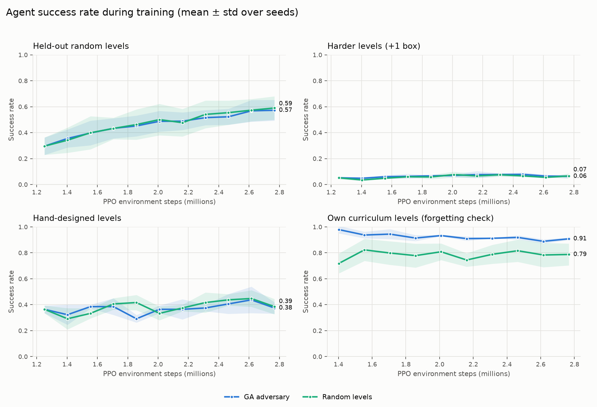
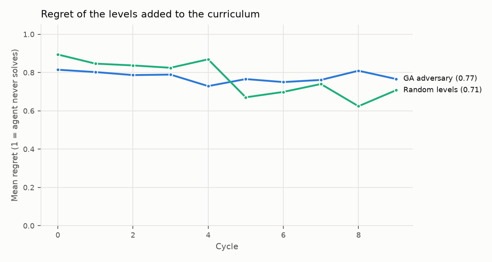
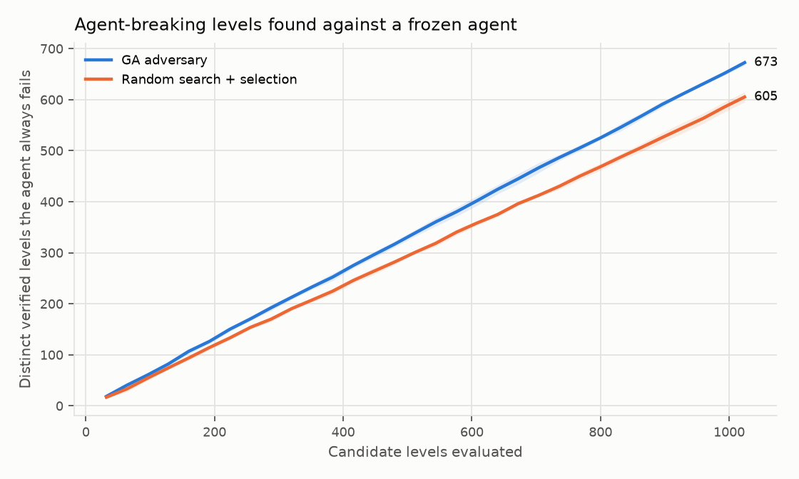

# Results

Experiment directory: `runs\ued_9x9_1box`

Final success rates (stochastic policy), mean ± std across seeds; Δ vs GA with bootstrap 95% CI and exact permutation p-value.

## Held-out random levels

| Condition | Seeds | Success rate | Δ (GA − this) | 95% CI | p |
|---|---|---|---|---|---|
| GA adversary | 3 | 0.579 ± 0.093 | – | – | – |
| Random levels | 3 | 0.611 ± 0.122 | -0.032 | [-0.190, +0.135] | 0.600 |

## Harder levels (+1 box)

| Condition | Seeds | Success rate | Δ (GA − this) | 95% CI | p |
|---|---|---|---|---|---|
| GA adversary | 3 | 0.064 ± 0.007 | – | – | – |
| Random levels | 3 | 0.064 ± 0.003 | +0.000 | [-0.009, +0.008] | 1.000 |

## Hand-designed levels

| Condition | Seeds | Success rate | Δ (GA − this) | 95% CI | p |
|---|---|---|---|---|---|
| GA adversary | 3 | 0.365 ± 0.039 | – | – | – |
| Random levels | 3 | 0.422 ± 0.135 | -0.057 | [-0.234, +0.078] | 0.900 |

## Adversarial levels (other seeds' GA)

| Condition | Seeds | Success rate | Δ (GA − this) | 95% CI | p |
|---|---|---|---|---|---|
| GA adversary | 3 | 0.494 ± 0.056 | – | – | – |
| Random levels | 3 | 0.443 ± 0.085 | +0.051 | [-0.061, +0.167] | 0.600 |

## Failure-discovery efficiency (frozen agent)

| Method | Breaking levels found (mean ± std) | Evaluations to find 10 | Evaluations to find 25 | Evaluations to find 50 |
|---|---|---|---|---|
| GA adversary | 672.7 ± 5.2 | 32 (3/3 seeds) | 64 (3/3 seeds) | 96 (3/3 seeds) |
| Random search + selection | 605.3 ± 9.8 | 32 (3/3 seeds) | 64 (3/3 seeds) | 107 (3/3 seeds) |

## Figures

